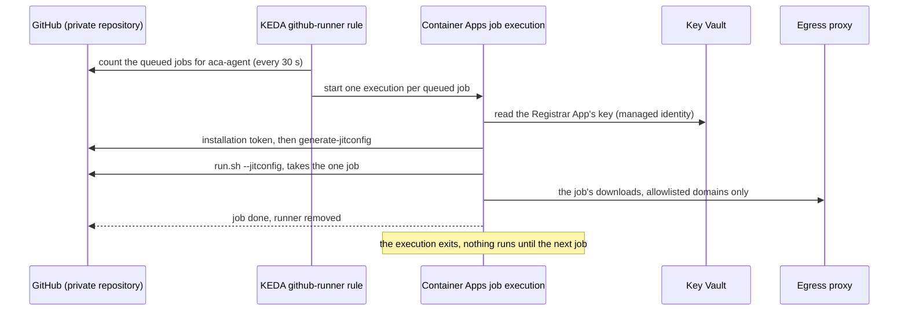

<div align="center">

# Ephemeral GitHub Actions runners on Azure Container Apps

**One queued job, one single-use runner: Azure Container Apps jobs scaled by KEDA, registered just in time with a GitHub App whose key stays in Key Vault, reaching the internet through an allowlist proxy. No personal access token, no stored secret, nothing running while idle.**

[](https://github.com/ikhemissi/github-runners-on-container-apps/actions/workflows/ci.yml)
[](LICENSE)
[](infra)
[](azure.yaml)
[](runner)

[**Key findings**](#key-findings) · [**How it works**](#how-it-works) · [**Cost**](#cost) · [**Set it up**](#set-it-up) · [**Documents**](#documents)

</div>


**Question:** Can ephemeral, single-use GitHub Actions runners on Azure Container Apps jobs run a private repository's workflows (up to about 3 hours) securely, without PATs or stored secrets, at zero idle cost?

**Answer:** yes, for workflows that need no container engine. A private course repository's CI and its Copilot cloud agent run on these runners: about a minute from a queued job to a running one, no secret outside Key Vault, and no compute while idle; the registry and the logs cost a few dollars a month. Details: [findings](docs/FINDINGS.md).

**Time box:** 6 phases, stop and report after each · **Status:** done (November 2026)

## Key findings

| Question | Answer | Evidence |
|---|---|---|
| One job per runner? | Yes: a just-in-time runner takes one job, then leaves the repository's runner list. | [01](docs/experiments/01-runner-image-locally.md), [03](docs/experiments/03-job-started-by-hand.md) |
| Labels | A JIT runner has only the labels it is given: workflows ask for `runs-on: aca-agent`, not `[self-hosted, …]`. | [D9](docs/DECISIONS.md) |
| Scaling | One execution per queued job, none while idle (0 → 0, 1 → 1, 4 jobs with 3 at most → 3 then 1), with the scaler's `enableEtags` off and a 5-minute idle watchdog. | [04](docs/experiments/04-event-scaling.md), [D15](docs/DECISIONS.md) |
| Cancellations and timeouts | Ten jobs at once and a job cancelled at its `timeout-minutes` left no execution and no runner; an execution ends within 5 s of its job's cancellation. | [06](docs/experiments/06-egress-and-private-networking.md) |
| Long jobs | A three-hour job ran to its end on one runner; its token and egress still worked, and the execution ended 4 s after it. Keep the 3.5-hour replica timeout above the longest `timeout-minutes`. | [08](docs/experiments/08-long-job.md) |
| Start-up | About 30 s from an execution's start to its job (2.5 GB image, 15 s of it the pull); about a minute from a queued job to a running one. | [03](docs/experiments/03-job-started-by-hand.md), [06](docs/experiments/06-egress-and-private-networking.md) |
| Secrets | The two GitHub Apps' keys stay in Key Vault; a job step reaches the managed identity endpoint but gets 403 without its header, which no process keeps. | [03](docs/experiments/03-job-started-by-hand.md), [SECURITY](docs/SECURITY.md) |
| Azure from workflows | Steps sign in through GitHub OIDC as an identity the job never holds; the token's subject carried immutable IDs. | [05](docs/experiments/05-oidc-and-budget.md), [D16](docs/DECISIONS.md) |
| Egress | An allowlist proxy and a network security group limit the runners to listed domains; the course's CI needed two domains beyond the obvious ones. | [06](docs/experiments/06-egress-and-private-networking.md), [D20](docs/DECISIONS.md) |
| Copilot cloud agent | Runs on these runners, with its integrated firewall off and sessions started with Environment → Actions. | [07](docs/experiments/07-copilot-cloud-agent.md), [D23](docs/DECISIONS.md) |
| Containers | No Docker or Podman inside a Consumption execution: container actions, `services:` and dev-container builds stay on GitHub-hosted runners. | [03](docs/experiments/03-job-started-by-hand.md), [D13](docs/DECISIONS.md) |

## How it works



- **Two GitHub Apps, no personal access token:** a Scaler App (Actions: read) for KEDA, its key a Key Vault-referenced secret of the job; a Registrar App (Administration: write, one repository) for the [entrypoint](runner/entrypoint.sh), which clears every identity variable before the runner starts.
- **Single use:** `replica_retry_limit = 0`, one job per execution, and a watchdog that removes a runner that gets no job.
- **Workflow steps and Azure:** GitHub OIDC with a federated credential on a separate `deployer` identity, for one GitHub environment that accepts `main` only.
- **Egress (optional, `EGRESS_PROXY`):** Squid in an internal Container Apps environment allows only [allowlist.txt](egress-proxy/allowlist.txt); the runners' subnet is denied the internet but for what the platform and the scaler need.
- **Infrastructure:** one Terraform root ([infra/](infra)), deployed with azd; private networking for Key Vault behind `PRIVATE_NETWORKING` (off).

## Cost

Measured with Cost Management for the resource group (USD, November 2026): 0.58 on the deployment day and 1.50 on a day of heavy testing (dozens of executions, the egress proxy deployed, the environments replaced). While idle, executions cost nothing; the registry (Basic, 0.1666 a day, about 5 a month), the logs (per GB ingested) and, when on, the proxy's single replica remain. A monthly budget alerts the resource group's Owners ([D19](docs/DECISIONS.md)). For comparison, Azure Firewall Basic alone would cost about 259 € a month ([D20](docs/DECISIONS.md)).

## Set it up

Prerequisites: an Azure subscription, the Azure CLI, azd and Terraform 1.11 or later; a private GitHub repository to serve. Then follow [BOOTSTRAP](docs/BOOTSTRAP.md): the azd environment, the two GitHub Apps and their keys, OIDC for workflows, the budget, the images and the egress proxy, and the Copilot cloud agent.

```bash
azd env new runners-dev --location francecentral
azd env set RESOURCE_TAGS "key=value,key=value"   # tags your tenant's policies require, if any
azd hooks run preprovision                        # remote state backend: once before the first preview
azd provision --preview                           # read the plan
azd provision
```

Day-to-day: [OPERATIONS](docs/OPERATIONS.md) (queries, troubleshooting). Tear it down: `azd down --purge`.

## Run the checks

```bash
make lint         # shellcheck and hadolint
make test         # the runner image: its tools, sudo keeping the proxy settings, the entrypoint's offline tests
make test-proxy   # the egress proxy image: allowlisted domains pass, others are denied (needs internet access)
make test-infra   # Terraform offline: fmt, validate, tflint, Trivy, terraform test with mock providers
```

CI runs them on every push ([ci.yml](.github/workflows/ci.yml)); plans and applies run from the maintainer's machine only ([D22](docs/DECISIONS.md)).

## Documents

| Document | Content |
|---|---|
| [Findings](docs/FINDINGS.md) | The answer, with the evidence and what's left open |
| [PRD-001](docs/prd/PRD-001-ephemeral-runners.md) | Requirements and phases |
| [Decisions](docs/DECISIONS.md) | Choices and departures from the PRD (D1–D23) |
| [Questions](docs/QUESTIONS.md) | What the spike had to answer, and the status of each question |
| [Experiments](docs/experiments/README.md) | One file per experiment, 00–07 |
| [Security](docs/SECURITY.md) | Secrets, identities, egress, residual risks |
| [Bootstrap](docs/BOOTSTRAP.md) · [Operations](docs/OPERATIONS.md) | Setting it up; running it |
| [Retest plan](docs/RETEST-PLAN.md) · [Demo runbook](docs/DEMO-RUNBOOK.md) | What to run again when something changes; how to show it |
| [Runner image](runner/README.md) · [Target repository examples](examples/target-repository) | The image and its entrypoint; workflows to copy |
