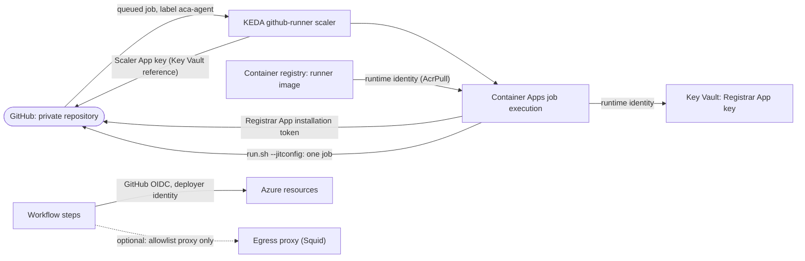

# Ephemeral GitHub Actions runners on Azure Container Apps

**Question:** Can ephemeral, single-use GitHub Actions runners on Azure Container Apps jobs run a private repository's workflows (up to about 3 hours) securely, without PATs or stored secrets, at zero idle cost?

**Time box:** 6 phases, stop and report after each · **Status:** in progress

## The setup

A queued workflow job with the label `aca-agent` makes the KEDA scaler of an Azure Container Apps job start one execution. Its container registers one just-in-time runner for the repository, with a GitHub App installation token minted from a private key it reads in Key Vault through its managed identity. The runner takes that one job, then the container exits. With nothing queued, nothing runs. No personal access token or stored secret: the two GitHub Apps' keys live in Key Vault, and workflow steps reach Azure through GitHub OIDC with an identity the job never holds. Optionally (`EGRESS_PROXY`), the runners reach the internet only through an allowlist proxy. Requirements: [PRD-001](docs/prd/PRD-001-ephemeral-runners.md); departures from it: [decisions](docs/DECISIONS.md); [security](docs/SECURITY.md).



The runner image and its tests: [runner/README.md](runner/README.md). Progress, phase by phase: [experiments](docs/experiments/README.md).

## Key findings

TODO: once the first experiments are done, one line per question (a table), and a diagram of the most important
behaviour when it helps (a `sequenceDiagram`).

The answers to every question, with the evidence: **[docs/FINDINGS.md](docs/FINDINGS.md)**.

## Documents

| Document | Content |
|---|---|
| [Questions](docs/QUESTIONS.md) | What the spike must answer, and the status of each question |
| [Experiments](docs/experiments/README.md) | One file per experiment, numbered |
| [Findings](docs/FINDINGS.md) | The answers, with links to the evidence |
| [Retest plan](docs/RETEST-PLAN.md) | What to run again when a product changes |
| [Demo runbook](docs/DEMO-RUNBOOK.md) | How to show the results |

## Environment

The infrastructure is one Terraform root (`infra/`), one file per part, built from the modules in `infra/modules/`. azd runs the steps of `infra/hooks/<event>/` around it (state backend before, configuration after, a clean teardown).

```bash
az login && azd auth login
azd env new runners-dev --location francecentral
azd env set RESOURCE_TAGS "key=value,key=value"   # tags your tenant's policies require, if any
azd hooks run preprovision                        # remote state backend: once before the first preview
azd provision --preview                           # read the plan
azd up                                            # provision, then deploy the services
```

Later changes: `azd provision --preview`, read the plan, then `azd provision`.

Tear it down when the spike ends: `azd down --purge`.

## Run the experiments' code

```bash
uv sync
uv run python src/<script>.py
```
